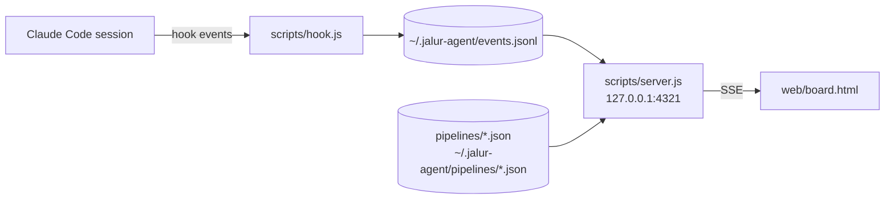

# Architecture



| Part | Job |
|---|---|
| `hooks/hooks.json` | Registers `PreToolUse`, `PostToolUse`, `UserPromptSubmit`, `Stop` → `scripts/hook.js` |
| `scripts/hook.js` | Writes one redacted JSON line per event. Swallows every error and always exits 0, so it can never block a session |
| `scripts/server.js` | Serves the board, streams `events.jsonl` over Server-Sent Events, serves pipeline configs (user folder wins over bundled) |
| `scripts/start.js` | Starts / stops / reports the server in the background (`/jalur-agent:board`) |
| `web/board.html` | Pairs Pre/Post events, splits runs per session, infers the phase from pipeline rules, renders the map, log and stats |

## Event format

```json
{"ts":1795686401080,"session":"abcd1234","event":"PreToolUse","kind":"Shell","text":"npm test -- --token=***","tid":"toolu_bbb222"}
{"ts":1795686401351,"session":"abcd1234","event":"PostToolUse","kind":"Shell","tid":"toolu_bbb222","ok":false}
```

`tid` is the end of `tool_use_id` and pairs a call with its result. The file rotates to `events.jsonl.old` past 5 MB.

## Phase inference

- A **run** starts at each call of the pipeline's `startSkill` and holds that session's events until the next start in the same session, so parallel sessions never mix.
- Each event is matched against `rules` top to bottom; the first match whose `from` is satisfied moves the phase to `to`. Phases only move forward.
- A call of another skill listed in `skills`, or of the `Agent` tool, is drawn as a transfer at the current station.
- A run is done at the last station once Claude finishes its answer (`Stop`).

## Design decisions

1. **Infer phases from tool calls**, not from markers the skill must emit: works with any existing skill. Trade-off: similar steps can be mis-placed; rules are data so they can be tuned.
2. **Never disturb the session:** the hook has no dependencies, a 5 s timeout and swallows all errors.
3. **Store summaries, not content:** made to be shown on a screen; prompts, file contents and diffs never touch disk.
4. **Node only, no Docker, no database:** one JSONL file is enough for a single developer.
